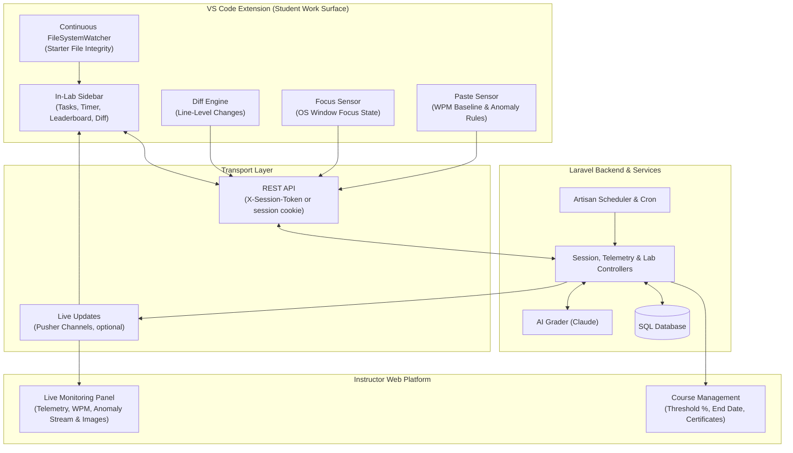

# CertiCode Labs

> **Next-Generation AI-Proctored Programming Laboratory & Assessment Platform**  
> Integrated seamlessly with the **CertiCode Labs VS Code Extension**, **Laravel 12 Backend**, **Pusher Channels live updates**, and **Instructor Live Monitoring Dashboard**.

---

## Table of Contents
- [Overview](#overview)
- [Core Features & Architecture](#core-features--architecture)
  - [1. Lab Availability Modes: Live Lab vs. Open Lab](#1-lab-availability-modes-live-lab-vs-open-lab)
  - [2. Real-Time Line Diff Tracking](#2-real-time-line-diff-tracking)
  - [3. Collaborative Team Chat & Ephemeral Storage](#3-collaborative-team-chat--ephemeral-storage)
  - [4. AI Proctoring & Anomaly Telemetry](#4-ai-proctoring--anomaly-telemetry)
  - [5. Camera Presence Gate & Continuous Verification](#5-camera-presence-gate--continuous-verification)
  - [6. In-Lab VS Code Sidebar & Live Leaderboard](#6-in-lab-vs-code-sidebar--live-leaderboard)
  - [7. Instructor Live Monitoring Panel](#7-instructor-live-monitoring-panel)
  - [8. Session Closure, Course Competency & E-Certification](#8-session-closure-course-competency--e-certification)
- [System Architecture](#system-architecture)
- [Getting Started](#getting-started)
  - [Prerequisites](#prerequisites)
  - [Installation](#installation)
  - [Environment Configuration](#environment-configuration)
  - [Running the Local Development Stack](#running-the-local-development-stack)
- [VS Code Extension](#vs-code-extension)
  - [Installing Pre-built VSIX](#installing-pre-built-vsix)
  - [Building from Source](#building-from-source)
- [Automated Testing](#automated-testing)
- [Production & Cloud Deployment](#production--cloud-deployment)
  - [Vercel Serverless & Cron Execution](#vercel-serverless--cron-execution)
- [License](#license)

---

## Overview

**CertiCode Labs** is an intelligent coding lab and proctoring platform designed to evaluate programming competencies in realistic IDE environments. Rather than confining students to basic web code editors, CertiCode Labs connects directly to **Microsoft VS Code** via a dedicated companion extension while streaming real-time telemetry, line-level contributions, and live leaderboards back to the instructor dashboard.

---

## Core Features & Architecture

### 1. Lab Availability Modes: Live Lab vs. Open Lab
Instructors configure lab accessibility independently of participation mode (Solo or Team):
* **Live Lab**:
  * Inaccessible to students until the instructor manually opens it (`openLive`).
  * Runs on a **shared synchronous countdown timer** for all students simultaneously.
  * Late joiners receive only the remaining window time.
  * When the timer expires, all active sessions are auto-submitted and closed; late joiners are strictly blocked (`live_expired`).
  * If reopened, countdown resumes with leftover time only, unless explicitly extended with additional minutes.
* **Open Lab**:
  * Self-paced; available immediately upon creation throughout active course duration.
  * Individual per-student timer begins when the student initiates the lab.
  * An attempt ends when it is submitted, when the instructor ends it, or when the course concludes. It stops accepting work once the per-student time limit and a short grace period run out.
  * An optional due date shows students how long is left, then how late they are. Late work is still accepted.

### 2. Real-Time Line Diff Tracking
* Calculates line-level deltas (`+added`, `-deleted`, `~modified`) against the original starter file baseline in real time.
* **Solo Mode**: Tracks personal diff stats and displays compact diff counters in the VS Code sidebar.
* **Team Mode**: Shows each teammate's share of the team's changed lines, with avatar colors and contribution percentages. It counts lines per teammate; it doesn't attribute individual lines.
* **Transport**: The extension sends diffs over REST. When Pusher is set up, the server broadcasts them (`DiffUpdated`) to the sidebar and the monitoring panel. Without it, both poll.

### 3. Collaborative Team Chat & Ephemeral Storage
* Embedded in the VS Code sidebar and web platform exclusively during team exercises.
* Partitioned strictly by `group_id` and `lab_session_id`.
* **Ephemeral Lifecycle**: Auto-cleared and purged from the database immediately upon session completion.

### 4. AI Proctoring & Anomaly Telemetry
* **WPM Behavioral Baseline**: Tracks continuous typing speed over rolling time windows.
* **Smart Paste Anomaly Detection**:
  * **Suppression Rule A**: Ignores paste if content matches the lab's starter files, or is the student's own code: already in the same file, in an open lab file, or cut from one of them earlier in the attempt.
  * **Suppression Rule B**: Ignores paste if content matches recent snippets from the active team chat.
  * **Clipboard Check**: Flags a remaining paste to the instructor panel, without interrupting the student, only if the inserted text is on the clipboard. These rules are deterministic; no AI reviews a paste.
  * **Large Insert Check**: Flags 100 or more characters of code that arrive without being typed or pasted, such as from an AI tool. Blocks that arrive within a few seconds count as one insert. Generated code and large snippets can also raise it, so the flag is medium severity.
* **Focus-Lost Tracking**: Hooks OS-level VS Code window focus (`onDidChangeWindowState`), ignoring sidebar tab switches.

### 5. Camera Presence Gate & Continuous Verification
* **Pre-Lab Gate**: Requires browser webcam permission and passes on-device face detection (face-api) before the lab workspace is unlocked. A dim room gets a stronger check on a brightened frame, but a face must still be detected. A pass in a dim room is recorded for the instructor. Three failed checks in a row lock the lab for 15 minutes and alert the instructor. Every way of starting a lab needs a recent pass, but detection runs in the browser and the server trusts the face count it reports. A student who crafts that request can pass the gate, so the check deters and doesn't prove presence.
* **Continuous Background Proctoring**: Performs non-interruptive periodic background presence checks. Mid-session face-loss alerts are quietly streamed to the instructor with snapshot attachments while the student continues working.

### 6. In-Lab VS Code Sidebar & Live Leaderboard
* Live session timer countdown synced with backend.
* Task checklists with completion statuses and instant AI compiler/runtime feedback.
* **Task Failure Rule**: If code contains compiler/runtime errors, the task is marked failed automatically.
* **Live Leaderboard**: Displays rank ordered by tasks completed (descending) with completion time as the tiebreaker.

### 7. Instructor Live Monitoring Panel
* Roster view sortable alphabetically by student last name or team group name.
* Live metric stream displaying real-time WPM, completed task counters, and team contribution percentages.
* Comprehensive chronological anomaly timeline with captured camera snapshot previews.

### 8. Session Closure, Course Competency & E-Certification
* **Lab Closure**: Closes open attempts with their last graded score, updates competency scores, and purges chat. Closing doesn't call the AI grader.
* **Course Completion**: Counts the labs where a student reached the class's lab pass score, and compares that share of all labs with an instructor-configured passing threshold (e.g. 75%). Grades awaiting instructor review do not count. Competency scores are tracked separately and do not affect certificates.
* **E-Certification**: Issues certificates with QR codes to qualifying students when the class ends, or earlier when a student claims one. Each has a random verification code that a public page looks up in the database; certificates are not cryptographically signed.

---

## System Architecture



---

## Getting Started

### Prerequisites
* **PHP 8.2+** (with `bcmath`, `curl`, `mbstring`, `pdo_sqlite` or `pdo_mysql`, `fileinfo`)
* **Composer 2+**
* **Node.js 18+** & **npm 9+**
* **Microsoft VS Code** (version 1.75.0 or later)

### Installation

1. **Clone the repository**:
   ```bash
   git clone https://github.com/vhengie02/Certicode-Labs.git
   cd "Certicode Labs"
   ```

2. **Install PHP dependencies**:
   ```bash
   composer install
   ```

3. **Install JavaScript dependencies**:
   ```bash
   npm install
   ```

4. **Prepare Environment File**:
   ```bash
   cp .env.example .env
   php artisan key:generate
   ```

5. **Run Database Migrations & Symlink Storage**:
   ```bash
   php artisan migrate
   php artisan storage:link
   ```

---

### Environment Configuration

Key variables in `.env`:

```ini
# Application URL
APP_URL=http://localhost:8000

# Database
DB_CONNECTION=sqlite

# Live updates. Leave as null to poll instead; set to pusher with the keys below to enable them.
BROADCAST_CONNECTION=null
# PUSHER_APP_ID=
# PUSHER_APP_KEY=
# PUSHER_APP_SECRET=
# PUSHER_APP_CLUSTER=mt1

# AI Evaluation Engine
ANTHROPIC_API_KEY=your-anthropic-api-key

# Cron Security Token (Used by Vercel Cron / Cloud Scheduler)
CRON_SECRET=your-secure-cron-token
```

---

### Running the Local Development Stack

Run each component in a separate terminal window:

```bash
# 1. Laravel Web Application
php artisan serve

# 2. Frontend Asset Bundler
npm run dev

# 3. Background Scheduled Tasks (auto-close expired live labs & conclude classes)
php artisan schedule:work
```

---

## VS Code Extension

The companion extension enables students to code in their native VS Code editor with starter files, live task checklists, diff pill counters, and proctoring telemetry.

### Installing Pre-built VSIX
The pre-compiled extension package (**v1.8.9**) is maintained in `public/downloads/certicode-labs.vsix`:

```bash
code --install-extension public/downloads/certicode-labs.vsix --force
```

### Building from Source
To compile and package the extension manually:

```bash
cd certicode-labs-extension
npm install
npx tsc -p ./
npx @vscode/vsce package -o ../public/downloads/certicode-labs.vsix
```

---

## Automated Testing

CertiCode Labs includes a test suite covering:
* Live Lab availability lifecycle, synchronous countdowns, and late-joiner gating
* Pre-lab camera face detection gates and continuous proctoring
* OS focus loss and typing anomaly telemetry
* Real-time WebSocket broadcasting events
* Course conclusion and certificate issuance
* Multi-file starter code synchronization and REST fallback

Run the test suite:
```bash
php artisan test
```

---

## Production & Cloud Deployment

### Vercel Serverless & Cron Execution
The repository includes a production-ready `vercel.json` configuration:
* **Serverless PHP Runtime**: Routes web requests through `api/index.php`.
* **Static Assets**: Automatically maps `/build/*` and `/downloads/*` (direct `.vsix` distribution).
* **Automated Vercel Crons**: Configured to call `/api/cron/tick` once a day, at 16:00 UTC:
  ```json
  "crons": [
    {
      "path": "/api/cron/tick",
      "schedule": "0 16 * * *"
    }
  ]
  ```
  The `/api/cron/tick` endpoint executes:
  1. `certicode:close-expired-live-labs`
  2. `certicode:auto-conclude-expired-classes`
  3. `model:prune` for old anomalies and telemetry
  4. `certicode:expire-old-snapshots`

  A live lab doesn't wait for this tick. An expired lab stops accepting work after a 60-second grace period, and it closes the next time a student or the monitoring panel loads it. A class past its end date concludes the first time anyone opens its page, or on the daily tick if nobody does. The schedule stays daily because the Vercel Hobby plan doesn't allow more frequent crons.

---

## License

This project is licensed under the MIT License.
