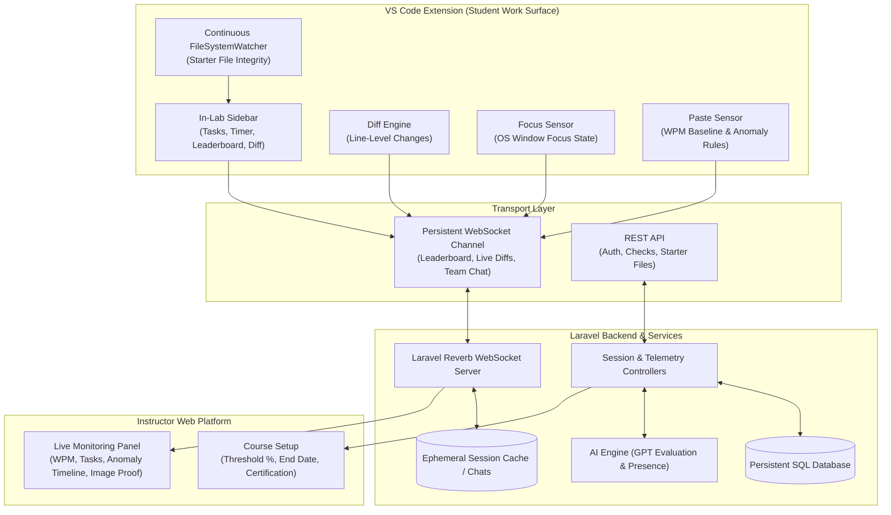

# CertiCode Labs — Project To-Do & Feature Roadmap

This document outlines the final feature specifications, implementation tasks, architectural requirements, and progress across the CertiCode Labs platform (VS Code Extension, Laravel Backend, and Instructor Web Dashboard).

---

## 📋 Feature Roadmap Summary (Final Specification)

| Feature | Primary Scope | Status | Transport / Protocol |
| :--- | :--- | :--- | :--- |
| **1. Diff Tracking** | VS Code Extension, Backend & Dashboard | ✅ Completed | WebSocket (Solo & Team) + REST Fallback |
| **2. Team Chat** | Extension & Web Platform (Team Mode Only) | ✅ Completed | WebSocket + Ephemeral Storage |
| **3. Auto-Generated Starter Files** | Extension & Instructor Dashboard | ✅ Completed | REST + Local FileSystemWatcher |
| **4. Paste Anomaly Detection** | Extension, Backend & Telemetry Sensor | ✅ Completed | WebSocket / REST Telemetry |
| **5. In-Lab Sidebar (Leaderboard, Tasks, Timer, Focus)** | VS Code Extension & Backend | ✅ Completed | WebSocket (Solo & Team) |
| **6. Instructor Live Monitoring Panel** | Web Platform (Instructor-Facing) | ✅ Completed | Live Telemetry & Polling Stream |
| **7. Session Closure vs. Course Completion & Certification** | Backend, Web Platform & Database | ✅ Completed | REST + Lifecycle Evaluation |
| **8. Camera Presence Check** | Pre-Lab Gate & Ongoing Proctoring | ✅ Completed | WebRTC / Video Capture + AI |
| **9. Lab Availability Modes (Live Lab vs. Open Lab)** | Backend, Web Platform & VS Code Extension | ✅ Completed | REST + Shared Live Window & Scheduled Cron |
| **10. AI Grade Summary & Explanation (with Instructor Overrides)** | Backend, Instructor Web Platform & LLM Service | ✅ Completed | REST + Same-Call AI Response + Side-by-Side Audit Trail |
| **11. Idle Detection** | Extension, Backend Telemetry & Monitoring | ✅ Completed | WebSocket / REST Telemetry |

---

## Feature 1: Diff Tracking

### Specification
- **Trigger**: Student edits any file in the lab workspace.
- **Baseline**: Instructor-provided starter file for the exercise.
- **Solo Mode**: Track lines added/removed by the student only.
- **Team Mode**: Track lines added/removed per teammate, attributed at the line level (`git blame` style).
- **Transport**: WebSocket for both modes — solo-mode diff data rides the same WebSocket connection already open for the leaderboard (Feature 5), rather than separate REST polling.
- **Output Destinations**: VS Code sidebar (live view), instructor analytics dashboard (aggregated + per-student view).
- **Dependencies**: Requires authenticated student identity per edit (for team attribution).

### Technical Requirements & Progress
- [x] **Snapshot Baseline Caching ([`sidebarProvider.ts`](file:///C:/Users/vheng/PROJECTS/Certicode%20Labs/certicode-labs-extension/src/sidebarProvider.ts))**:
  - In-memory starter file snapshot baseline created immediately on workspace generation.
- [x] **Line Diff Calculation Engine**:
  - Calculates line-level delta (`+added`, `-deleted`, `~modified`) relative to original starter snapshots on document edit/save.
- [x] **Sidebar Diff View & Pill Counters**:
  - Compact diff pill counter (`+X / -Y`) in sidebar header.
  - Dedicated "Diff View" tab with per-file breakdown and aggregate stats.
- [x] **Team Attribution & Line-Level Blame Data Model**:
  - Tags change blocks with user ID, name, initials, and assigned avatar color.
  - Backend schema: `diff_stats` and `code_contributions` JSON columns in `lab_sessions` table.
- [x] **Instructor Dashboard Visualization**:
  - Visual breakdown per student in team sessions on the web platform (percentage bars, lines added/deleted).
- [x] **Transport Unification (WebSocket for Solo & Team)**:
  - Unified diff transport over persistent WebSocket channel (`DiffUpdated` event) streaming directly to students and instructors with automated high-frequency REST fallback when disconnected.
- [x] **Real-Time Instructor Analytics Stream**:
  - Broadcast line-level diff updates over WebSocket to instructor live dashboard for instant real-time telemetry updates.

---

## Feature 2: Team Chat

### Specification
- **Applies to**: Team-mode exercises only. Not present in solo mode.
- **Team Assignment**: Instructor-defined at exercise creation (instructor sets `mode = solo | team`, and assigns members if team).
- **Visibility**: Private to the student's own team. Instructor has no access to content.
- **Persistence**: Cleared on session end. Not stored beyond session lifetime (ephemeral lifecycle).
- **Transport**: WebSocket.
- **Surfaces**: VS Code sidebar panel + web platform.

### Technical Requirements & Progress
- [x] **Instructor Team Configuration**:
  - Exercise mode flag (`solo` vs `team`) and group assignment schema in instructor dashboard.
- [x] **Conditional Extension UI**:
  - Team Chat tab rendered in VS Code sidebar exclusively during team-mode lab sessions; hidden in solo mode.
- [x] **Privacy Enforcement**:
  - Chat channels partitioned by `group_id` / `lab_session_id`.
  - Instructor live feeds and grading panels strictly exclude chat content.
- [x] **Ephemeral Storage & Lifecycle**:
  - Chat table `lab_session_chats` keyed to `lab_session_id`.
  - Auto-cleared / cascade-deleted upon session termination.
- [x] **Sidebar Chat Component**:
  - Unread message badge, sender initials/color, timestamp formatting, code snippet attachment syntax styling.
- [x] **Web Platform Chat Integration**:
  - Embedded chat panel in `resources/views/laboratories/show.blade.php`.
- [x] **WebSocket Broadcast Integration**:
  - Migrated chat synchronization to low-latency WebSocket broadcasting (`ChatMessageSent` on `lab-session.{sessionId}.chat`) across both extension and web surfaces with automatic seamless fallback.

---

## Feature 3: Auto-Generated Starter Files

### Specification
- **Trigger**: Student starts an exercise.
- **Config Source**: Instructor-defined per exercise — includes file count (1 or more), filenames, folder structure, and optional pre-filled content (sample code / comments).
- **Separation of Concerns**: Task instructions live in a dedicated sidebar field (not in-file). In-file content (sample code/comments) is separate and optional.
- **Submission Validation Rule**: Exact filenames required.
- **Validation Mode**: Continuous. The extension watches the workspace via a file-system watcher for the full duration of the session — not just at submit time.
- **Enforcement Rule**: IF expected file is missing/renamed/deleted at any point → show inline warning immediately, naming the specific file → disable Submit button until resolved.

### Technical Requirements & Progress
- [x] **Exercise Schema Multi-File Support**:
  - Added `starter_files` JSON column to `laboratories` table (`[{"name": "...", "content": "...", "is_primary": bool, "is_readonly": bool}]`).
- [x] **Instructor Dashboard Exercise Editor**:
  - Dynamic multi-file manager in `create.blade.php` and `edit.blade.php` with primary file selector and readonly toggles.
- [x] **Workspace File Provisioning**:
  - Automatically provisions starter files in student's active workspace folder upon session connect.
  - Automatically opens primary file in active editor tab.
- [x] **Continuous Client-Side FileSystemWatcher ([`sidebarProvider.ts`](file:///C:/Users/vheng/PROJECTS/Certicode%20Labs/certicode-labs-extension/src/sidebarProvider.ts))**:
  - Registered `vscode.workspace.createFileSystemWatcher` monitoring additions, deletions, and renames.
  - Verifies presence and exact naming of all expected starter files against the manifest for the entire session.
- [x] **Inline Warning & Reactive CTA Locking**:
  - Renders inline warning in sidebar naming missing/renamed files (`Missing: <filename> — this file is required for submission`).
  - Automatically disables Submit button while file structure is invalid.
- [x] **Separation of Concerns**:
  - Instructions, rubrics, and task objectives remain in sidebar; workspace files contain only runnable code/comments.
- [x] **Each lab gets its own starter files (extension 1.7.1)**:
  - Starter files that already existed were never replaced, so a new lab in the same folder kept (and graded) the previous lab's code. The extension now remembers which session wrote each file: resuming keeps the student's work, and a file from another lab prompts to replace it after saving the old copy in `.certicode/previous`.

---

## Feature 4: Paste Anomaly Detection

### Specification
- **Signal 1**: WPM tracked continuously as a behavioral baseline.
- **Signal 2**: Paste event detected (block of code appears without incremental typing).
- **Suppression Rule A (Internal Move/Restructure)**: IF pasted content matches text that already existed elsewhere in the same file → do NOT flag.
- **Suppression Rule B (Permitted Collaboration)**: IF pasted content matches recent content from the team chat → do NOT flag.
- **Flagging Rule**: IF paste is external AND fails both suppression checks → run AI comparison against exercise context to confirm it's not a false positive → THEN flag.
- **Flag Visibility**: Instructor only. Never shown to student.
- **Flag Scope**: Session-scoped. Does not persist or accumulate across sessions.

### Technical Requirements & Progress
- [x] **Continuous WPM Behavioral Tracker (Extension)**:
  - Track keystrokes over moving time window to establish real-time WPM baseline in editor.
- [x] **Paste Event Interceptor**:
  - Hook `vscode.workspace.onDidChangeTextDocument` to detect multi-character insertion blocks appearing within a single tick.
- [x] **Suppression Rule A (Internal File Match)**:
  - Check inserted block against pre-existing document text buffers or baseline snapshot; ignore if content was moved or duplicated internally.
- [x] **Suppression Rule B (Team Chat Match)**:
  - Check inserted block against local session team chat buffer (snippets sent within last N minutes); ignore if content originated from active team chat.
- [x] **Anomaly Telemetry & Contextual Verification Endpoint**:
  - Endpoint `/api/v1/sessions/{id}/telemetry` logging `paste_anomaly` with length, snippet metadata, and rolling WPM.
- [x] **Session-Scoped Anomaly Logging**:
  - Record confirmed paste anomalies in `anomalies` table (`type = paste_anomaly`, `severity = medium|high`, `metadata`).
  - Ensure lifecycle is bounded strictly to session duration (flushed/reset across sessions).
- [x] **Student Blindness Enforcement**:
  - Suppress any indicator of paste flags in the extension sidebar and student dashboard; surface solely on instructor views.
- [x] **Fewer false paste flags (extension 1.7.1)**:
  - Snippet expansions, quick fixes, completions and reloads from disk no longer count. A large insertion is flagged only when it matches the clipboard (ignoring whitespace) in a document the student edited.

---

## Feature 5: In-Lab Sidebar (Live Leaderboard, Tasks, Timer, Focus Tracking)

### Specification
- **Location Constraint**: All live in-session UI (leaderboard, task list, timer) is rendered in the VS Code sidebar — NOT a browser tab (active student work surface is VS Code).
- **Leaderboard**:
  - **Visibility**: All students (not instructor-only).
  - **Ranking Metric**: Tasks completed.
  - **Tiebreaker**: Time taken to finish.
  - **Update Mode**: Live, via WebSocket.
  - **Scope**: Applies to BOTH solo and team labs — solo labs hold a WebSocket connection specifically for this (and carry diff data, per Feature 1).
- **Task Failure Rule**: IF submitted code contains errors → mark task as failed automatically, regardless of completion attempt.
- **Focus / Anomaly Tracking**:
  - **Signal Used**: VS Code window OS-level focus state (`vscode.window.onDidChangeWindowState`).
  - **Flag Condition**: VS Code loses OS focus (student switched to another application or window).
  - **Non-Condition**: Switching between panels inside the VS Code sidebar (task list ↔ chat ↔ leaderboard ↔ diff view) — internal navigation, never flagged.

### Technical Requirements & Progress
- [x] **Core In-Lab Sidebar Layout**:
  - Session timer countdown/elapsed display synced with backend.
  - Task checklists with completion statuses (Done/Pending) and AI feedback.
- [x] **Sidebar Leaderboard Tab**:
  - Add "Leaderboard" tab in VS Code sidebar webview displaying all session students/teams with rank, tasks count, and elapsed time.
- [x] **Live Leaderboard Channel**:
  - Persistent channel & endpoint (`/sessions/{id}/leaderboard`) across both solo and team lab sessions.
  - Auto-rank by tasks completed (descending) with completion time as tiebreaker (ascending).
- [x] **Strict Task Failure on Code Errors**:
  - Evaluate compiler/runtime output during code execution: if errors occur, auto-mark active task as failed regardless of user attempt.
- [x] **OS-Level Focus Loss Detection**:
  - Register `vscode.window.onDidChangeWindowState` in extension host.
  - Trigger telemetry anomaly event (`type = focus_lost`) when `window.focused` transitions to `false`.
- [x] **Internal Navigation Whitelist**:
  - Ensure sidebar tab switching (Tasks ↔ Chat ↔ Leaderboard ↔ Diff) remains purely webview-internal and does not trigger window focus-lost events.

---

## Feature 6: Instructor Live Monitoring Panel (Browser, Instructor-Facing)

### Specification
- **Location**: Web platform, not VS Code.
- **Scope**: Per lab session. Lists all students (solo) or teams (team mode) in that session.
- **Sort Options**: Alphabetical by last name; alphabetical by group name.
- **Per-Student/Team Detail View (on click)**:
  - Live WPM baseline & current rate.
  - Tasks completed count.
  - Full anomaly history for the session (not just latest): camera-absence events (with captured image), paste flags, focus-loss events.
  - IF team mode → drill-down available to see individual teammate contribution (pulls from Feature 1 diff data).

### Technical Requirements & Progress
- [x] **Instructor Live Monitoring Route & View**:
  - Blade template and controller: `resources/views/instructor/monitoring/session.blade.php` and `InstructorMonitoringController`.
- [x] **Roster Grid & Sorting**:
  - Card/table roster listing active students (solo) or teams (team mode).
  - Client-side and server-side sorting: alphabetical by student last name, alphabetical by group name.
- [x] **Real-Time Live Telemetry Widgets**:
  - Live WPM metric stream and completed task counter per student/team.
- [x] **Comprehensive Session Anomaly History**:
  - Chronological activity log showing all session anomalies: focus losses, paste flags, and camera absences.
- [x] **Anomaly Snapshot Gallery**:
  - Image thumbnail & modal preview displaying captured camera snapshots for camera-absence events.
- [x] **Team Contribution Drill-Down**:
  - Sub-drawer showing individual teammate lines added/deleted and percentage contribution from Feature 1 diff data.
- [x] **Integrity Flag Triage ([`ClassController.php`](file:///C:/Users/vheng/PROJECTS/Certicode%20Labs/app/Http/Controllers/ClassController.php))**:
  - The class telemetry flags table sorts by student, lab, type, severity, time or status (`?sort=&dir=`, newest first by default).
  - `POST /classes/{class_id}/anomalies/resolve` resolves several open flags at once; IDs outside the class are ignored.
  - A daily `model:prune` deletes resolved flags older than `ANOMALY_RETENTION_DAYS` (default 90). Open flags are never pruned. On Vercel it runs from `/api/cron/tick` (`CronController`), because the Laravel scheduler doesn't run there.
  - Covered by [`IntegrityFlagsTest.php`](file:///C:/Users/vheng/PROJECTS/Certicode%20Labs/tests/Feature/IntegrityFlagsTest.php).

---

## Feature 7: Session Closure vs. Course Completion & Certification

### Specification

#### Part A: Individual Lab Session Closure (repeats — once per lab)
- **Trigger**: Instructor ends that specific lab session.
- **On End**: In-progress work auto-submitted → assessed → results recorded against that lab's competency.
- **Lifecycle**: WebSocket connections for that session (chat, diff, leaderboard) terminated and cleared — not preserved.
- **Certification State**: No certificate issued at this stage; this only locks in that session's results.
- **Reopening**: Reopenable by the instructor (e.g., disconnected student); WebSocket connections re-established fresh on reopen, not restored from prior state.

#### Part B: Course/Classroom Completion & Certificate Issuance (one-time — end of course)
- **Trigger**: Instructor manually ends the course, OR a scheduled end date the instructor set in advance is reached — whichever comes first.
- **Evaluation**: The system evaluates each student's accumulated results across every lab session held during the course.
- **Passing Rule**: Student must meet an overall completion threshold across required competencies — instructor-configurable per course (e.g., 75%), not fixed platform-wide, and not requiring 100%.
- **Certification**: Students at or above their course's threshold receive an e-certificate, functioning as a course-completion diploma.
- **Hard Cutoff**: Hard cutoff: no grace period or resubmission once the course ends — threshold is checked against whatever results exist at that moment.
- **Config Implication**: Course setup requires two new instructor-facing settings — (1) passing threshold percentage, (2) optional scheduled end date — alongside existing per-lab settings.
- **Data Implication**: Per-session results must persist and accumulate at the student level for the whole course.

### Technical Requirements & Progress
- [x] **Individual Lab Session Closure Handler**:
  - Endpoint `POST /instructor/sessions/{id}/end` to force auto-submission of pending student workspaces.
  - Auto-assess code and persist scores into `student_competencies` table.
  - Broadcast termination event across session WebSocket channels and disconnect sockets.
  - Flush ephemeral chat data (`lab_session_chats`).
- [x] **Lab Session Reopening Workflow**:
  - Endpoint `POST /instructor/sessions/{id}/reopen` allowing instructor to grant access with fresh WebSocket channels.
- [x] **Course Schema Migration (`school_classes`)**:
  - Add `passing_threshold` (integer percentage, e.g. 75, default 75) and `scheduled_end_date` (nullable timestamp) to `school_classes` table.
- [x] **Instructor Course Configuration UI**:
  - Add passing threshold percentage input and scheduled end date datetime picker to class creation/edit forms.
- [x] **Course Expiration Scheduler**:
  - Scheduled Artisan command running periodically to check for classes reaching `scheduled_end_date` and trigger auto-closure.
- [x] **Course Completion Evaluation Engine**:
  - Aggregate competencies earned across all completed labs in the course against required competencies.
  - Calculate student course grade / competency attainment percentage against configured threshold.
- [x] **Automated E-Certificate Generation**:
  - Generate `Certificate` record with cryptographic verification code and QR code for qualifying students (>= threshold).
  - Hard lock: block submissions and modifications once course is ended.


---

## Feature 8: Camera Presence Check (face-api.js)

### Specification
- **Checkpoint 1: Pre-Lab Gate Check (One-Time)**:
  - Requires camera permission via browser `getUserMedia()`.
  - IF permission denied or missing camera → student CANNOT start the lab. Hard block with clear requirement notice.
  - IF permission granted → captures single frame and runs client-side face detection using `SsdMobilenetv1` (accurate, heavier, run once).
  - IF face detected → Gate passes, unlocks workspace, initiates normal start flow.
  - IF no face detected → Do not unlock. Prompt student to reposition in front of webcam with 3-attempt retry limit.
  - IF all 3 attempts fail → Hard-block student from lab, display contact instructor alert, and log failure attempt with static JPEG snapshot to backend proctoring telemetry endpoint (`prelab_verification_failed`).
- **Checkpoint 2: Continuous Re-Verification (Active Session)**:
  - Fixed interval (every 25 seconds) running lightweight `TinyFaceDetector` against background video stream.
  - IF face detected → Take NO action. Zero network traffic, zero backend logging, zero student disruption.
  - IF no face detected (`camera_absence`) → Capture that specific frame as a static JPEG image and send telemetry event to `POST /api/v1/sessions/{id}/telemetry`.
  - Critical constraint: Detection failure must be completely silent on student's end — NEVER interrupt, pause, warn, or block student's work mid-session.
- **Constraints & Edge Cases**:
  - Zero external CDN dependencies: self-hosted `face-api.js` (`public/js/` & extension `media/js/`) and local models (`public/models/` & extension `media/models/`).
  - Minimal model footprint: load only `SsdMobilenetv1` and `TinyFaceDetector`. No landmarks, expressions, age/gender, or recognition descriptors.
  - Privacy first: client-side inference in browser/webview sandbox; only flagged failure snapshots are sent to backend.

### Technical Requirements & Progress
- [x] **Self-Hosted Library & Model Weights ([`public/js/face-api.min.js`](file:///C:/Users/vheng/PROJECTS/Certicode%20Labs/public/js/face-api.min.js), [`public/models/`](file:///C:/Users/vheng/PROJECTS/Certicode%20Labs/public/models/))**:
  - Installed `face-api.js` locally with zero CDN dependencies.
  - Deployed `SsdMobilenetv1` and `TinyFaceDetector` manifests and binary weights to `public/models/` and `certicode-labs-extension/media/models/`.
- [x] **Pre-Lab Camera Permission & Presence Gate ([`show.blade.php`](file:///C:/Users/vheng/PROJECTS/Certicode%20Labs/resources/views/laboratories/show.blade.php) & [`sidebarProvider.ts`](file:///C:/Users/vheng/PROJECTS/Certicode%20Labs/certicode-labs-extension/src/sidebarProvider.ts))**:
  - Web dashboard & VS Code sidebar hard-blocks students until camera permission is granted.
  - One-time AI presence verification runs `SsdMobilenetv1` against live camera capture with 3-attempt retry limit before permanent block and telemetry alert.
- [x] **Continuous Background Presence Verification ([`sidebarProvider.ts`](file:///C:/Users/vheng/PROJECTS/Certicode%20Labs/certicode-labs-extension/src/sidebarProvider.ts))**:
  - Runs `TinyFaceDetector` every 25 seconds against silent off-screen camera video.
  - Zero network traffic when face is present.
  - Dispatches compressed static JPEG snapshot with `camera_absence` event on face absence.
- [x] **Silent Student Proctoring & Instructor Telemetry ([`LabSessionController.php`](file:///C:/Users/vheng/PROJECTS/Certicode%20Labs/app/Http/Controllers/Api/LabSessionController.php))**:
  - Mid-session checks never disrupt or block student coding activity.
  - Validates snapshots (JPEG/PNG, max 300 KB), keeps them in the anomaly's `metadata.image_base64`, and serves them only to the class instructor via `GET /anomalies/{id}/snapshot`. Broadcasts `AnomalyDetected` with the snapshot URL; the live alert shows a thumbnail.
- [x] **Camera Flag De-duplication**:
  - A disconnected camera is reported once by the lab page; the server drops repeat camera flags (5 min without a picture, 20 s with one).
- [x] **Leave the lab when VS Code closes**:
  - Extension 1.6.0 reports its window closing (`POST /sessions/{id}/vscode-disconnect`); the lab page stops the camera and returns to the lab view. A crash is caught after two missed extension pings (~40 s). The session stays in progress.
- [x] **Extension version check**:
  - The extension sends `X-Extension-Version`; builds below `services.vscode_extension.min_version` (or sending none) get an update banner on the lab page and a warning in VS Code.
  - The VS Code sidebar shows the installed extension version on the connection and session screens.
- [x] **Fewer false "multiple faces" flags ([`show.blade.php`](file:///C:/Users/vheng/PROJECTS/Certicode%20Labs/resources/views/laboratories/show.blade.php))**:
  - `countFaces()` treats the largest face as the student. Another face counts only if it is confident (score ≥ 0.5), not a duplicate box of the student's face, and at least 20% of its size.
- [x] **Server-side camera gate**:
  - Starting a lab needs the server's own record of the camera check (kept 10 minutes); a `camera_verified` flag from the browser no longer skips it. A low-light pass is logged as `low_light`, and the low-light option is hidden after a multiple-faces failure.
- [x] **Face models actually load on Vercel**:
  - `public/models` and `public/fonts` are routed as static files; before, they 404ed and in-lab detection silently fell back to the brightness check.
- [x] **No tab-switch flags for normal work**:
  - The lab page going out of view behind VS Code is logged as `lab_page_hidden` and not counted; real switching raises one flag per 2-minute window.
- [x] **Instructor hears about camera flags with monitoring closed**:
  - The first camera flag (`no_face`, `multiple_faces`) in a lab after 15 quiet minutes sends the class instructor an in-app notification (`CameraFlagNotification`, no email) linking to the lab's monitoring. Later flags in the same spell show on the monitoring page only.
- [x] **A VS Code reload no longer exits the lab**:
  - VS Code shuts the extension down the same way for a reload and a close. The server now counts VS Code as closed only 30 s after a clean shutdown with no new ping (`vscode_reconnecting` until then), and extension 1.8.0 resumes the session if it starts again within 25 s. The token is kept in VS Code's SecretStorage. Older builds still exit the lab, 30 s later than before.
- [x] **Outdated extensions on the monitoring page**:
  - The lab roster shows an "Old ext" badge next to in-progress students whose last extension ping came from a build below `min_version`.
- [ ] **Follow-ups**:
  - Tune face-detection thresholds (0.10–0.15) and the low-light heuristic against real webcams.
  - After deploying, check on the live site that the face models load and that a lab can't start without passing the camera check.
  - Delete legacy public snapshot files under `storage/app/public/anomalies/` once no longer needed.
  - Release extension 1.8.0 (rebuild the `.vsix`) so the reload fix reaches students.
- [x] **Automated Test Coverage ([`TelemetryAndProctoringTest.php`](file:///C:/Users/vheng/PROJECTS/Certicode%20Labs/tests/Feature/TelemetryAndProctoringTest.php))**:
  - Automated tests for permission denial, absence anomaly recording, multi-face detection, pre-lab 3-attempt failure reporting, and camera verification status persistence.

---

## Feature 9: Lab Availability Modes — Live Lab vs. Open Lab

### Specification
When creating a lab exercise, the instructor selects one of two availability modes: **Live Lab** or **Open Lab**. This setting is completely orthogonal to the solo vs. team participation mode (Feature 2) — instructors can combine either availability mode with either participation mode.

#### 1. Live Lab
- **Manual Open Trigger**: The lab is inaccessible to students until the instructor manually opens it — there is no scheduled auto-start. Before manual open, students see the lab locked/not yet started.
- **Fixed Duration Window**: When opening, the instructor sets a total duration (e.g., 60 minutes). This starts a synchronous countdown from the exact moment of instructor activation — not when individual students join.
- **Shared Countdown Across All Students**: Every student shares the identical end time. If opened at 2:00 PM for 60 minutes, the lab closes for everyone at 3:00 PM regardless of when individual students join.
  - *Example*: In a 60-minute Live Lab, Student A joins at minute 0 and gets 60 minutes. Student B joins 20 minutes late and gets 40 minutes.
- **Automatic Auto-Close & Auto-Submit**: When the shared timer reaches zero:
  - The lab automatically closes for all students simultaneously.
  - All active, in-progress sessions are auto-submitted immediately as-is, following the Feature 7A closure evaluation sequence.
- **Late Joiner Rules**:
  - While the live countdown is running, late joiners can join and receive whatever remaining time is left.
  - Once the countdown reaches zero, the lab is closed and late joiners are completely blocked from starting (`live_expired` status).
- **Reopening Rules**:
  - If the instructor reopens a closed Live Lab, students do NOT get a fresh duration.
  - The countdown resumes with only the leftover remaining time from the original window.
  - If reopened after full expiration (`remaining <= 0`), the instructor must explicitly provide additional minutes (`extend_minutes` / `add_minutes`).

#### 2. Open Lab
- **Self-Paced Availability**: Open by default upon creation. Students can access and complete the lab at their convenience anytime during the active course.
- **Independent Per-Student Timer**: The timer (if set) is per-student and begins individually when that student clicks "Start Lab".
  - *Example*: In a 60-minute Open Lab, Student A starts at 10:00 AM and has until 11:00 AM. Student B starts days later and gets their own full 60 minutes.
- **Closure Rules**: Not tied to a shared countdown. An Open Lab closes only when:
  1. The instructor manually closes an individual student's session (Feature 7A), or
  2. The instructor concludes the entire course / course end date passes (Feature 7B).

### Technical Requirements & Progress
- [x] **Database Schema & Migration ([`2026_09_17_010000_add_availability_mode_to_laboratories_table.php`](file:///C:/Users/vheng/PROJECTS/Certicode%20Labs/database/migrations/2026_09_17_010000_add_availability_mode_to_laboratories_table.php))**:
  - Added `availability_mode` (`enum('open', 'live')`, default `'open'`).
  - Added `live_duration_minutes` (`integer`, nullable).
  - Added `live_status` (`enum('not_started', 'active', 'closed')`, default `'active'`).
  - Added `live_started_at` (`timestamp`, nullable).
  - Added `live_elapsed_seconds` (`integer`, default 0).
- [x] **Laboratory Model State Machine ([`app/Models/Laboratory.php`](file:///C:/Users/vheng/PROJECTS/Certicode%20Labs/app/Models/Laboratory.php))**:
  - Helpers: `isLiveLab()`, `isOpenLab()`, `isLiveActive()`, `isLiveNotStarted()`, `isLiveClosed()`.
  - Timer computations: `getLiveTotalDurationSeconds()`, `getLiveElapsedSeconds()`, and `getRemainingLiveSeconds()`.
  - Lifecycle actions: `openLive(?int $durationMinutes)`, `closeLive()`, `reopenLive(?int $extendMinutes)`, and proactive auto-close checker `checkAndAutoCloseLive()`.
- [x] **Controller Endpoints & Authorization**:
  - [`LaboratoryController.php`](file:///C:/Users/vheng/PROJECTS/Certicode%20Labs/app/Http/Controllers/LaboratoryController.php):
    - `store()` & `update()` validation and persistence of availability mode and live duration.
    - `startSession()` gates students from starting locked or expired Live Labs.
    - Added `openLive()`, `endLive()`, and `reopenLive()` with instructor/admin authorization.
  - [`Api/LabSessionController.php`](file:///C:/Users/vheng/PROJECTS/Certicode%20Labs/app/Http/Controllers/Api/LabSessionController.php):
    - `startSession()` returns 403 `live_not_started` or `live_expired` blocks.
    - `getSession()` returns shared countdown metrics (`time_remaining_seconds`, `is_live_expired`, `shared_countdown`, `live_status`).
    - `getLeaderboard()` includes shared live countdown for all participants.
    - Exposed authenticated API endpoints for `open-live`, `end-live`, and `reopen-live`.
- [x] **Artisan Background Scheduled Worker ([`routes/console.php`](file:///C:/Users/vheng/PROJECTS/Certicode%20Labs/routes/console.php))**:
  - Command `certicode:close-expired-live-labs` scheduled to run `everyMinute()` to proactively close expired Live Labs and auto-submit student sessions.
- [x] **Instructor Web Dashboard & Student Views**:
  - [`create.blade.php`](file:///C:/Users/vheng/PROJECTS/Certicode%20Labs/resources/views/laboratories/create.blade.php) & [`edit.blade.php`](file:///C:/Users/vheng/PROJECTS/Certicode%20Labs/resources/views/laboratories/edit.blade.php): Interactive availability mode selector cards with configurable live duration input.
  - [`show.blade.php`](file:///C:/Users/vheng/PROJECTS/Certicode%20Labs/resources/views/laboratories/show.blade.php): Visual badges (Live Lab vs Open Lab, status pill), student locked/expired notices, and instructor lifecycle buttons (`Open Live Lab`, `End Live Lab`, `Reopen Live Lab`).
  - [`resources/views/instructor/monitoring/session.blade.php`](file:///C:/Users/vheng/PROJECTS/Certicode%20Labs/resources/views/instructor/monitoring/session.blade.php): Real-time shared countdown banner with status badge and inline lifecycle controls.
- [x] **VS Code Extension Integration ([`sidebarProvider.ts`](file:///C:/Users/vheng/PROJECTS/Certicode%20Labs/certicode-labs-extension/src/sidebarProvider.ts))**:
  - Handled 403 `live_not_started` and `live_expired` gating on session connect.
  - Added `#live-lab-alert` box rendering locked/expired notifications.
  - Shared countdown synchronization across active students, freezing submission buttons when expired.
  - Live Lab shared clock badge in leaderboard view.
  - Compiled and packaged extension to `public/downloads/certicode-labs.vsix`.
- [x] **Automated Feature Verification ([`tests/Feature/LiveLabAvailabilityTest.php`](file:///C:/Users/vheng/PROJECTS/Certicode%20Labs/tests/Feature/LiveLabAvailabilityTest.php))**:
  - 12 comprehensive unit and integration tests covering: Open Lab default behavior, Live Lab creation, student gating before open, instructor manual start, late joiners receiving shared countdown, auto-close on timer expiry, late joiners blocked when expired, early close by instructor, and leftover-only reopening.
  - Full suite verification: 118 passing tests with 483 assertions.

---

## Feature 10: AI Grade Summary & Explanation (with Instructor Grade Overrides)

### Specification
- **Trigger & Coupling**: Generated at student (or team) submission time inside the *same single AI call* in [`LlmEvaluationService.php`](file:///C:/Users/vheng/PROJECTS/Certicode%20Labs/app/Services/LlmEvaluationService.php) that computes the pass/fail score (no redundant follow-up calls).
- **Target Output Shape**:
  ```json
  {
    "competencies": {
      "oop_inheritance": { "passed": true, "reason": "..." },
      "exception_handling": { "passed": false, "reason": "..." }
    },
    "test_cases_passed": 7,
    "test_cases_total": 10,
    "code_quality_notes": "...",
    "summary": "Full plain-language explanation..."
  }
  ```
- **Visibility**: Instructor-only. Students never see the AI summary — it's a grading and review aid for the instructor, not student-facing feedback. Stripped from all student-facing endpoints. The one exception is `ai_grade_summary.student_feedback`: the feedback the student was already shown at submit time, kept for their results page.
- **Team Labs**: Evaluates and explains the team's combined final submission as a single unit without breaking down individual teammate contributions (diff tracking and grading are separate concerns).
- **Grade Override Audit Trail**: Instructors can review the submission and override the grade with an optional reason note. Preserves both records side-by-side:
  1. Original AI score (`performance_score`) + `ai_grade_summary` (untouched).
  2. Override fields: `instructor_grade_override`, `instructor_override_reason`, `instructor_overridden_at`, `overridden_by`.
- **Where Displayed**: In the Instructor Live Monitoring Panel ([`session.blade.php`](file:///C:/Users/vheng/PROJECTS/Certicode%20Labs/resources/views/instructor/monitoring/session.blade.php)), accessible via a dedicated "Grade Review & AI Summary" button in each student/team row with a side-by-side audit modal and inline manual override form.

### Technical Requirements & Progress
- [x] **Database Schema Migration ([`2026_09_22_122120_add_ai_grade_summary_and_overrides_to_lab_sessions_table.php`](file:///C:/Users/vheng/PROJECTS/Certicode%20Labs/database/migrations/2026_09_22_122120_add_ai_grade_summary_and_overrides_to_lab_sessions_table.php))**:
  - Added `ai_grade_summary` (JSON), `instructor_grade_override` (numeric), `instructor_override_reason` (text), `instructor_overridden_at` (timestamp), and `overridden_by` (foreign key) to `lab_sessions`.
- [x] **Eloquent Model Upgrades ([`LabSession.php`](file:///C:/Users/vheng/PROJECTS/Certicode%20Labs/app/Models/LabSession.php))**:
  - Added fields to `$fillable` and `$casts`.
  - Added relationship `overriddenByUser()` to [`User`](file:///C:/Users/vheng/PROJECTS/Certicode%20Labs/app/Models/User.php).
  - Added helper accessors: `getEffectiveScoreAttribute()` and `isGradeOverridden()`.
- [x] **Single-Call AI Prompt & Normalization ([`LlmEvaluationService.php`](file:///C:/Users/vheng/PROJECTS/Certicode%20Labs/app/Services/LlmEvaluationService.php))**:
  - Structured OpenAI prompt to return competencies dictionary, test counts, code quality notes, and plain-language summary in the same execution.
  - Upgraded fallback heuristic evaluator (`evaluateMock()`) and zero-state evaluator (`evaluateEmptySubmission()`) to produce the identical structured schema.
- [x] **Student Data Privacy ([`LabSessionController.php`](file:///C:/Users/vheng/PROJECTS/Certicode%20Labs/app/Http/Controllers/Api/LabSessionController.php))**:
  - Persisted `ai_grade_summary` in `submitSession()`.
  - Sanitized student JSON responses in `submitSession()` and `checkProgress()` to strictly omit `ai_grade_summary`, `competencies`, `code_quality_notes`, and `summary`.
- [x] **Instructor Override Endpoint & Data Streaming ([`InstructorMonitoringController.php`](file:///C:/Users/vheng/PROJECTS/Certicode%20Labs/app/Http/Controllers/InstructorMonitoringController.php))**:
  - Implemented `overrideGrade()` (`POST /instructor/sessions/{id}/override-grade`) with validation, authorization, audit logging, and `StudentCompetency` synchronization.
  - Streamed effective scores, override flags, audit notes, and AI grade summaries via `streamData()` and `show()`.
- [x] **Instructor UI & Audit Modal ([`session.blade.php`](file:///C:/Users/vheng/PROJECTS/Certicode%20Labs/resources/views/instructor/monitoring/session.blade.php))**:
  - Added live grade pill showing effective/overridden grade badge.
  - Added Alpine.js modal displaying AI vs. Effective scores side-by-side, full plain-language AI explanation, test results, competency checklist with reasons, and inline override form.
- [x] **Automated Test Verification ([`AiGradeSummaryAndOverrideTest.php`](file:///C:/Users/vheng/PROJECTS/Certicode%20Labs/tests/Feature/AiGradeSummaryAndOverrideTest.php))**:
  - Comprehensive feature tests covering persistence, student privacy, side-by-side audit preservation, authorization, and team submission unit evaluation (6 tests, 53 assertions).
- [x] **Grades can't be forged or changed after the attempt**:
  - Running code (`/execute`) no longer awards tasks or sets the score. Check-progress and submit refuse an attempt that has ended or run out of time, one grading run per session at a time.
  - A student leaving the lab no longer finalizes an ungraded attempt; the extension keeps Check/Submit disabled while a grade is pending.
- [x] **Submits fit Vercel's 60 s limit**:
  - The code is saved first, the grade gets one 40 s attempt, and the code run gets what's left of a 50 s budget.
- [x] **Syntax gate no longer fails valid code**:
  - Comments and strings are stripped per language before the check, and the repeated-character rule is gone.
- [x] **Student results page ([`summary.blade.php`](file:///C:/Users/vheng/PROJECTS/Certicode%20Labs/resources/views/sessions/summary.blade.php))**:
  - `GET /sessions/{id}` (`LabAttemptController::showWorkspace`) shows a finished attempt's grade, the instructor's regrade (old and new grade, who, when, full reason, earlier regrades from the `instructor_grade_override` telemetry), the task checklist with per-task feedback, and the session stats. An attempt still in progress opens its lab page; one whose submit is still grading shows a "Grading" page that reloads until the grade is in.
  - Open to the student, their team (group members), and class staff (`LabSession::isAccessibleBy`). A teammate sees only the team's attempts and not the owner's typing or focus figures. Reads only `needs_review` and `student_feedback` from `ai_grade_summary`.
  - Submit stores the student-facing feedback under `ai_grade_summary.student_feedback`, with the checklist as graded (task text included, so later lab edits don't relabel it). Lab notifications (submit and regrade) link to the page, the lab page opens it when the attempt ends, and lists past attempts.
  - The telemetry endpoint refuses server-only event types (`TelemetryLog::SERVER_EVENTS`), so a client can't forge a regrade record.
  - Tests: [`LabResultsPageTest.php`](file:///C:/Users/vheng/PROJECTS/Certicode%20Labs/tests/Feature/LabResultsPageTest.php).

---

## 🔒 Security & Deployment Hardening (October 2026 audit)

A multi-agent audit found 93 issues (5 critical, 17 high). All criticals and highs are fixed, each with a regression test.

- [x] **Critical fixes**: Google sign-in account takeover, student code running on the server without Judge0, grade forging through `/execute`, real credentials as config defaults, module attachments lost on Vercel's temporary disk.
- [x] **High fixes**: rate limits on sign-in, mail, codes and grading; lesson HTML sanitised; Gmail-link code capped and expiring; classes with certificates can't be deleted; extension state read from telemetry instead of the per-request cache; demo seeders blocked in production; Supabase signup trigger no longer takes the role from signup data.
- [x] **Attachments in Supabase Storage**: uploads and downloads go straight between the browser and storage through 5-minute signed URLs, so files up to 20 MB work despite Vercel's 4.5 MB request limit.
- [ ] **Follow-ups (owner)**:
  - Finish the post-audit production checklist (credentials, Supabase Auth settings, demo accounts). The details are kept outside this public repo.
  - Run the `2026_10_18_000000_stop_taking_role_from_supabase_signup_metadata` migration on Supabase.
  - Set the Vercel env vars: `DB_URL` (or `DB_*`), `JUDGE0_URL`, `ATTACHMENTS_DISK=supabase` and `SUPABASE_STORAGE_*`; set the bucket file-size limit to at least 20 MB.
  - Raise `VSCODE_EXTENSION_MIN_VERSION` to 1.7.1 if every student should update.
- [ ] **Follow-ups (code)**:
  - Try a real upload to the Supabase bucket after deploying.
  - Work through the audit's remaining 41 medium and 30 low findings (polling load, unbounded telemetry and snapshot growth, O(n²) plagiarism on every page load, no CI, Postgres-only paths untested on SQLite).

---

## Feature 11: Idle Detection

### Specification
- **Threshold**: 10 continuous minutes with zero activity — identical baseline across both Live Lab and Open Lab modes.
- **Activity Sensors & Reset Triggers**: Any of the following interactions immediately resets the student's idle timer:
  - Keystrokes (`vscode.workspace.onDidChangeTextDocument`).
  - Cursor movement (`vscode.window.onDidChangeTextEditorSelection`).
  - Scrolling (`vscode.window.onDidChangeTextEditorVisibleRanges`).
  - File switching (`vscode.window.onDidChangeActiveTextEditor`).
  - Running code / checking progress (`handleCheckProgress`, task starts, terminal usage).
  - Submitting the lab (`handleSubmit`).
  - Sending a team chat message (`handleSendChat`).
- **Recurring Notification Behavior**:
  - Triggers at 10 minutes of continuous inactivity, then recurs every additional 10 minutes of ongoing idle time (20 min, 30 min, etc.) — escalating severity (medium -> high).
  - **In a Live Lab**: Anomaly notification includes shared countdown context (e.g. `"Student Alice has been idle for 10 min; 22 min remain in this Live Lab"`), enabling instructors to immediately gauge remaining window risk.
  - **In an Open Lab**: Anomaly notification records standard idle alert without countdown reference (e.g. `"Student Alice has been idle for 10 min"`).
- **Team Labs**: Idle detection is strictly evaluated per-student session (`lab_session_id`). If one teammate is inactive while others code actively, only the idle student is flagged. Active teammate activity does not suppress individual disengagement.
- **WPM Interaction**: Idle time is NOT excluded from the WPM calculation (`WPM = (keystrokes / 5) / elapsed_minutes`). Idle gaps remain part of the session duration divisor, providing an honest pace without artificial inflation.
- **Scope & Telemetry Pipeline**: Tagged as `idle_timeout` in the proctoring pipeline (`anomalies` table), surfaced in instructor per-student anomaly history alongside camera absence, paste flags, and focus loss.

### Technical Requirements & Progress
- [x] **Activity Monitoring & Reset Engine ([`sidebarProvider.ts`](file:///C:/Users/vheng/PROJECTS/Certicode%20Labs/certicode-labs-extension/src/sidebarProvider.ts))**:
  - Registered listeners for keystrokes, selection changes, visible range changes, editor switching, task execution, terminal events, progress checks, submissions, and team chats to reset the 10-minute idle timer.
- [x] **Recursive Inactivity Dispatcher ([`sidebarProvider.ts`](file:///C:/Users/vheng/PROJECTS/Certicode%20Labs/certicode-labs-extension/src/sidebarProvider.ts))**:
  - Dispatches `idle_timeout` telemetry event at 10 minutes, recurring every 10 minutes thereafter (20m, 30m, etc.) with elapsed idle counter.
- [x] **Backend Anomaly Pipeline Integration ([`LabSessionController.php`](file:///C:/Users/vheng/PROJECTS/Certicode%20Labs/app/Http/Controllers/Api/LabSessionController.php))**:
  - Persists `idle_timeout` anomaly in database with escalating severity (`medium` at 10m, `high` >= 20m).
  - Automatically incorporates shared countdown remaining minutes when occurring in active Live Labs.
  - Broadcasts `AnomalyDetected` event in real time to instructor monitoring channel.
- [x] **Per-Student Isolation in Team Labs ([`LabSessionController.php`](file:///C:/Users/vheng/PROJECTS/Certicode%20Labs/app/Http/Controllers/Api/LabSessionController.php))**:
  - Binds anomaly strictly to the idle student's `lab_session_id`, ensuring active team members remain unaffected.
- [x] **WPM Idle Preservation ([`LabSession.php`](file:///C:/Users/vheng/PROJECTS/Certicode%20Labs/app/Models/LabSession.php) & [`sidebarProvider.ts`](file:///C:/Users/vheng/PROJECTS/Certicode%20Labs/certicode-labs-extension/src/sidebarProvider.ts))**:
  - Computes session-wide WPM using total elapsed minutes as divisor without deducting idle periods.
- [x] **Instructor UI Activity Feed ([`session.blade.php`](file:///C:/Users/vheng/PROJECTS/Certicode%20Labs/resources/views/instructor/monitoring/session.blade.php))**:
  - Visual idle clock badges, severity coloring, and Live Lab context in the instructor proctoring modal.
- [x] **Automated Feature Verification ([`TelemetryAndProctoringTest.php`](file:///C:/Users/vheng/PROJECTS/Certicode%20Labs/tests/Feature/TelemetryAndProctoringTest.php))**:
  - 5 dedicated integration tests verifying Open Lab, Live Lab countdown context, recurring escalation, team isolation, and WPM divisor preservation.

---

## 🛠 System Architecture & Protocol Split



### Protocol Guidelines
1. **Solo Labs**: Connect via WebSocket to handle the Live Leaderboard (Feature 5) and carry line-level diff updates (Feature 1).
2. **Team Labs**: Ride the same WebSocket connection to also broadcast Team Chat (Feature 2) and line-level teammate attribution.
3. **Ephemeral Lifecycle**: All WebSocket connections and chat records are scoped strictly to the active lab session and cleared upon session closure.
4. **Course Persistence**: Lab session results and competencies accumulate permanently at the student level for course-wide certificate determination.
